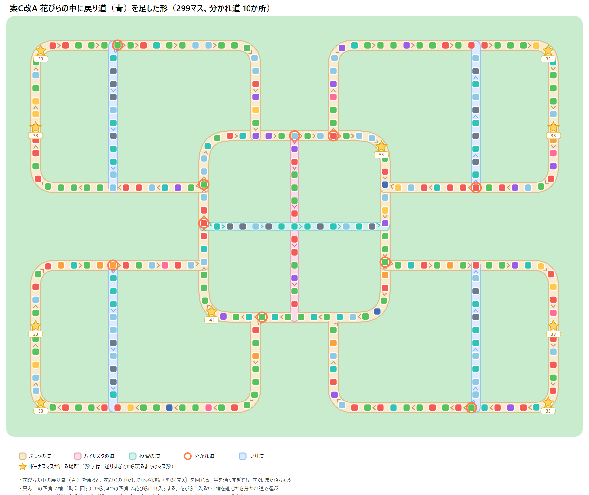

# LIFE & WEALTH ゲーム設計書（たたき台）

2026-10-22 時点（2026-10-29 に、段階9の内容（真ん中の輪と4つの花びらの盤面、花びらごとの株、ボーナス100万円、スタートでカード）を足した。2026-10-29 に、段階8の内容（十字型の盤面、道案内の看板、ボーナスマスの発表のタイミング、ギャンブルの結果の画面、ライバルの資産を見る画面、キャラクター）を足した。段階3.5で、遊びを作り直すために大きく書き直した。2026-10-21 にカード、ボーナスマス、大きなイベントを足した。2026-10-22 に、遊んでみて気になったところを直した（段階3.6、0.1）。2026-10-22 に、ニュースをランダムな月に出すなどの見直しをした（段階3.7、0.2））。前提は [requirements.md](requirements.md) を参照。作り直しの理由は [game-analysis.md](game-analysis.md) を参照。

この設計書は、プロトタイプを作るためのルールと数値を決めるものです。「（仮）」が付いた数値は遊びやすさを優先した仮の値で、あとで統計データや遊んだ感触で見直します。

数値の決め方:

- 設計書で決まっていない数値は、Claude が現実の水準に合わせて仮に決め、報告でまとめて確認する
- 数値は細かくしすぎず、中途半端な値にしない。金額は「10万円」「50万円」「300万円」のような区切りのよい値、割合は「5%」「10%」のような値にする
- 統計から調べた金額は、数万円の単位なら半端な値でもよいが、なるべく区切りのよい値に丸める

## 0. 段階3.5で変わったこと

| 項目 | 段階3まで | 段階3.5から |
| --- | --- | --- |
| 1ターン | 1年（22〜65歳の44ターン） | **1ヶ月** |
| 遊ぶ長さ | いつも44年 | 最初に **10・20・30・40・50年** から選ぶ。最初の設定は20年（240ターン、約30分） |
| 年齢 | 22歳〜65歳 | **自分の年齢はなくす**。「○年目 ○月」で数える。子どもの年齢だけ残す |
| 勝ち負け | 幸福度（幸福ポイント＋老後の安心ポイント）とランク | **最後の純資産**。幸福度とランクはなくす。CPU がいない間は、最後まで遊んだら終わり |
| ライバル | なし | CPU 2人（段階4で作る。12章） |
| 結婚・出産 | 自分で選ぶ | **ルーレットで決まる**（結婚・出産マス。v0.7.3 で1つにまとめた） |
| マスの出来事 | 選ぶものが多い（使う／見送るなど） | 多くは**運で起きるだけ**。選ぶのは「何を買うか」に絞る |
| マスの大きさ | 1年分の重み | **小・中・大**の3つに分け、小さな出来事を多くする |
| 投資の仕方 | 最初に「お金の分け方（方針）」を選び、自動で売り買い | 分け方はなくす。**年1回の取引タイム**で自分で売り買いし、投資信託とゴールドは**毎月の積み立て**ができる |
| 株 | 1種類 | **業種別の4つ**（IT・食品・エネルギー・銀行）。同じニュースでも動き方がちがう |
| 値動き | 年1回 | **毎月少しずつ**動き、年末のニュースで大きく動く |
| 投資の落とし穴 | なし | **投資の話のマス**（詐欺、流行りに飛びつく、借金して投資） |
| 不動産 | 自宅と投資用 | **自宅だけ**。投資用はなくす |
| 保険 | 保険マスで入る | **取引タイム**で入ったりやめたりする。保険マスはなくす |
| データ | プログラムのファイル（TypeScript） | 銘柄・ニュース・出来事・職業は **JSON ファイル**にする |
| 毎ターン決めること | ほぼない | **カード**（4種類）。ルーレットを回す前に、使うか取っておくかを決める（3.9） |
| すぐ先の目標 | ない | **ボーナスマス**。数ターン先のマスがボーナスマスになり、ぴったり止まるとボーナスがもらえる。早い者勝ち（3.10） |
| 大きな出来事 | 年末のニュースだけ（金融危機は25年に1回くらい） | **大きなイベント**（大暴落、大急騰、物価の急上昇、銀行の破綻、大地震、遺産の相続）が、1年のどの月でも突然起きる（5.3） |

### 0.1 段階3.6で直したこと

段階3.5を遊んでみて気になったところを直す。

| # | 気になったこと | 直し方 |
| --- | --- | --- |
| 1 | 1年に約2分かかり、長い | 1ターン＝1ヶ月のまま、最初は20年のままにする。2ヶ月・3ヶ月も比べたが、1ヶ月が一番自然と判断した。演出を速くしたり、止まる回数を減らしたりはしない（遊ぶ人の理解が追いつかなくなるため）。1ターンの長さは、データの数字1つで切り替えられる作りにだけしておく（11章） |
| 2 | 千円以下の単位がある | 扱わない。マスの出来事の金額は1万円単位にし、画面の金額もすべて万円で出す |
| 3 | 左上と右側の両方に資産が出ていて、複雑 | 左上は「何年目・純資産・景気・借金」だけにする。銀行預金と資産の内訳は、右側だけに出す |
| 4 | 結婚でルーレットが回らない | 結婚、出産、配偶者の働き方、子どもの進学で、ポップアップの中のルーレットが回って止まるようにする |
| 5 | 株の売り買いのとき、チャートが見られない | 取引タイムの銘柄ごとに「チャート」ボタンを付け、その銘柄の値動きのグラフを開けるようにする |
| 6 | 株は1株単位で買うのが現実的 | 株は1株単位で売り買いする（6.1）。投資信託・ゴールド・国債は、今のまま金額（1万円単位）で売り買いする |
| 7 | 取引画面で、持っている銘柄の利益が分からない | 銘柄ごとに、買った額の合計を覚えておき、「買った額・今の額・利益（＋○万円、＋○%）」を出す |
| 8 | カードを使うボタンがない | 手札が盤面の枠の外にはみ出して、隠れていた。手札を、盤面の左下に重ねて出す |
| 9 | お金が増えた・減ったのが分かりにくい | お金が動いたとき、右側の銀行預金と左上の純資産の数字が緑（増えた）・赤（減った）に光り、「＋30万円」のような金額が浮かび上がるようにする。凝った演出は段階4で作る |
| 10 | 決算が自動で消えて、内容が分からない | 年末のニュースと決算は、別々の画面のまま、どちらも「OK」を押すまで出しておく（2.2） |

- 数値（出来事の金額、ボーナス、確率など）は、あとでまとめて調整する

### 0.2 段階3.7で直したこと

| # | 気になったこと | 直し方 |
| --- | --- | --- |
| 1 | 年末に押す画面が多い（ニュース → 決算 → 取引タイム） | ニュースを年末から外し、1年のどの月でもランダムに出す（7章）。年末は決算だけにし、決算の画面に「取引タイムへ」と「次の年へ」のボタンを置く。取引タイムは、選んだときだけ開く（2.1） |
| 2 | お金が光る演出が、毎月光ってしまう | 光り方に3段階の強弱を付ける（2.2） |
| 3 | 投資の話の結果を見落としやすい | 年末の決算の画面にも、その年の投資の話の結果を出す（6.4） |
| 4 | 1ターンに、小さいお知らせ（自動で消える）と、マスの出来事・ニュースのポップアップがバラバラに出て、重なって見づらい。お金の出入りが把握できない | ターンの最後に「今月のまとめ」を1枚出す（2.3）。自動で消える小さいお知らせはやめる |
| 5 | 決算の画面が見づらい。今の純資産が分かりにくい | 今の純資産を一番上に大きく出し、純資産の中身と、去年から増えた・減ったわけを出す（2.1） |
| 6 | 取引タイムが見づらい。「買う」「売る」を先に選びたい | 罫線を入れた一覧から銘柄を選び、「買う」「売る」を選んでから金額（株数）を選び、「確定」で決める（2.1） |
| 7 | 結婚のルーレットが2回回る理由が分からない | ルーレットの上に、何を決めるか・なぜ大事か・どの目で何になるかを出す。2つあるときは1つずつ回す（3.8） |
| 8 | 金額の合計が、行を足した数と合わない（家計、ニュース） | 画面に出す行の金額（1万円単位に丸めたもの）を足して、合計を出す（2.2） |
| 9 | 細かい分かりづらさ | ニュースの表の見出し、株のマスの金額の二重表示、1万円未満の借金のお知らせ、ギャンブルの選び方（3.7）、捨てるカード（3.9）、家の返済額（6.2）、病気・失業の金額（5.1）を直す |
| 10 | 画面を見ないまま渡していた | 画面を自動で撮影する道具（Playwright）を使い、お渡しする前に、Claude が画面を撮影して確かめる（11章） |
| 11 | ニュースが「今月のまとめ」の中にあると、CPU や相手プレイヤーを足したときに困る（ニュースは全員に関係し、まとめはその人だけのもの） | ニュースは、まとめから外して、ニュースだけの画面で出す。順番は「今月のまとめ → ニュース」（2.2、2.3） |
| 12 | 取引タイムが分かりづらい（全部が縦に長く並ぶ、選んだ銘柄と売り買いの欄が離れる、「—」が多い、確定したあとに何が起きたか分からない） | 「売り買い」「積み立て」「保険・家」に分け、一覧と売り買いを左右に並べる。持っている・持っていないで分け、確定したら結果を出す。積み立ての「おすすめ」はなくす（2.1、6.3） |
| 13 | 小さな出来事が、今月のまとめの中で初めて出てきて、何が起きたか分かりにくい。お金の動きが追いにくい | マスの出来事の画面 → 給料と生活費のアクション → 今月のまとめ、の順に出す（2.2） |
| 14 | 結婚すると生活費が上がることが、金額で分からない | 「結婚しました！」の画面に、毎月の支出（共働きなら収入も）が何円から何円に変わるかを出す（3.5） |
| 15 | マスが少なく、20年で約12周して同じ並びを何度も見る | 200マスにする。結婚マスと出産マスを「結婚・出産マス」（6つ、必ず止まるマスにはしない）にまとめる（3.3、3.5）。全体図で拡大・縮小と移動ができるようにする（3.1） |
| 16 | 今月のまとめが、ライバルの番と給料のアクションのあとに出て、待たされる。まとめを見ている間、上の欄はもう次の月 | まとめをライバルの番より先に出す。まとめを閉じるまで、上の欄は前の月のまま（2.2、12.2） |
| 17 | マスに止まるまで、お金が増えるか減るか分からず、カードを使う理由がボーナスマスしかない | 出来事のマスを、プラス（緑）・マイナス（赤）・チャンス（黄色）に色分けする（3.3。段階5） |

- 出来事のあとの「ひとことの学び」と、遊び方の説明（チュートリアル）は、今は作らない（ロードマップの「後回し」）

## 1. ゲームの全体像

- 1人用。社会に出てから、選んだ年数のあいだ遊び、最後の純資産を競う
- 1ターン＝1ヶ月。毎月ルーレットで盤面を進み、止まったマスの出来事が起きる
- 1年（12ターン）ごとに、ニュースと決算を発表し、取引タイムで投資を見直す
- 税金や NISA などの制度は扱わない。収入はすべて手取りとして扱う
- CPU のライバル2人と、最後の純資産で競う（12章。段階4で作る）

```
タイトル → 年数を選ぶ → ルーレットで職業が決まる → スタート時の家計を確認 → 積み立ての金額を決める
  → 毎月のターン（12ターンごとに年末） → 最後の月で終了 → 結果画面
```

### 1.1 遊ぶ長さ

| 年数 | ターン数 | 1回遊ぶ時間（目安） |
| --- | --- | --- |
| 10年 | 120 | 約27分 |
| **20年（最初の設定）** | 240 | **約53分** |
| 30年 | 360 | 約80分 |
| 40年 | 480 | 約107分 |
| 50年 | 600 | 約133分 |

- 段階3.5で遊んで測った「1年に約2分」に、年末のニュースと決算で「OK」を押す時間を足した目安（1年に約2分40秒）
- 年齢はないので、どの年数を選んでも、同じルールで遊ぶ

## 2. 1ターン（1ヶ月）の流れ

| 順番 | フェーズ | 内容 |
| --- | --- | --- |
| 1 | カード | 手札のカードを使うか決める（使わなくてもよい。3.9） |
| 2 | 移動 | ルーレット（1〜6）を回し、出た数だけ進む |
| 3 | マス | 止まったマスの出来事が起きる（3章、5章） |
| 4 | 月末 | その月の値動き（7章）。給料が入り、生活費などが出ていく。積み立ての分を買う（6.3）。まれに大きなイベントが起きる（5.3） |
| 5 | 年末（12月だけ） | 決算 →（選んだときだけ）取引タイム（2.1）。子どもが1つ年を取る。給料が上がる |

月末の計算:

```
銀行預金 ＝ 銀行預金
      ＋ 給料（手取り）＋ 配偶者の給料
      − 職業の固定費 − 生活費 − 教育費 − 保育料 − ローン返済 − 保険料
      − 積み立て
```

- 金額のデータは1年分で持ち、1ヶ月分は12で割って計算する。画面には「約21万円」のように丸めて出す
- 給料は毎月同じ額にする。ボーナスは分けない（シンプルにするため）
- 利息と配当は、年末にまとめて入る
- ルーレットは出目を決める部分と見た目を分けて作り、あとでサイコロ（1〜6）に差し替えられるようにする

### 2.1 年末（12ターンごと）

| 順番 | 内容 |
| --- | --- |
| 1 | 決算: 1年分の収入と支出、純資産の増減、その年の投資の話の結果をまとめて見せる。「取引タイムへ」と「次の年へ」のボタンを置く |
| 2 | 取引タイム: 「取引タイムへ」を押したときだけ開く。投資を見直す（下の表） |
| 3 | 次の年へ: 子どもが1つ年を取り、進学などが起きる（5.2）。給料が上がる。物価が上がる |

- 政治・経済のニュースは、年末ではなく、1年のどの月でもランダムに起きる（7章）

決算の画面（段階3.7）:

```
┌ 3年目の決算 ────────────────────┐
│  今の純資産                           │
│  669万円                （大きな文字） │
│  去年より ＋228万円（去年 441万円）       │
│ 純資産の中身                           │
│   🏦 銀行預金 / 📈 投資 / 🏠 家 / 💳 借金・ローン │
│ 去年から増えた・減ったわけ                │
│   💼 働いて残したお金 / 💰 利息・配当 /      │
│   📈 投資の値動き / 🎲 出来事など           │
│ 🗣️ 投資の話の結果（あった年だけ）           │
│ （くわしい家計簿を見る）                  │
│ [取引タイムへ]        [次の年へ]         │
└───────────────────────┘
```

- くわしい家計簿は、上に収入、下に支出を縦に並べ、最後に「残ったお金」「そのうち、積み立てに回した」「銀行預金に残った」を出す
- 0円の行は出さない

取引タイムの画面（段階3.7。v0.7.1 で整理し直した）:

```
┌ 1年目の取引タイム ───────────────────────┐
│ 銀行預金 553万円   投資の合計 45万円           │
│ [ 売り買い ] [ 積み立て ] [ 保険・家 ]   ← 切りかえ │
├──────────────┬────────────────┤
│ 持っている             │ 投資信託                     │
│  ゴールド 45万 −3万    │  1年 +24%  （小さなチャート） │
│ 持っていない           │  ① 買う / 売る                │
│ ▶投資信託  1年 +24%    │  ② 1万 10万 50万 100万 全部   │
│  IT株 1株25万 1年 +26% │  銀行預金 553万 → 543万       │
│  …                     │            [確定]             │
├──────────────┴────────────────┤
│ ✔ 投資信託を 10万円 買いました                     │
│                                     [次の年へ] │
└──────────────────────────────┘
```

- 一番上に、銀行預金と投資の合計をいつも出す。売り買いすると、ここの数字が変わる
- 画面の上の「売り買い」「積み立て」「保険・家」で切りかえ、1回に1つだけ見せる。最初は「売り買い」
- 売り買い: 左に銘柄の一覧、右に選んだ銘柄の売り買いを並べる
  - 銘柄の一覧は「持っている」と「持っていない」に分ける。持っている銘柄は、持っている額（株は株数も）と利益（＋○万円、＋○%）を出す。持っていない銘柄は、1年の値動き（株は1株の値段も）を出す。「—」は出さない
  - 右には、銘柄の名前、1年の値動き（大きな文字）、小さなチャート、「① 買う / 売る」「② 金額」を出す。金額は投資信託・ゴールド・国債は 1万・10万・50万・100万円、株は 1株・3株・10株、それと「全部」
  - 「確定」を押す前に「銀行預金 553万円 → 543万円」のように、どうなるかを出す
  - 「確定」を押したら、「✔ 投資信託を 10万円 買いました」と下に出す（その取引タイムで行ったことを並べる）
  - スマホ（横向き）では、銘柄を押すと売り買いの画面に切りかわり、「もどる」で一覧に戻る
- 積み立て: 投資信託とゴールドの毎月の金額を「−1万」「＋1万」「しない」で変える。「おすすめ」のボタンは出さない
- 保険・家: 医療保険、火災保険、住宅ローンの繰り上げ返済、家の売却

取引タイムでできること:

| できること | 内容 |
| --- | --- |
| 売り買い | 株（4業種）・投資信託・国債・ゴールドを、1万円単位で売り買いする |
| 積み立ての変更 | 投資信託とゴールドの、毎月の積み立ての金額を変える |
| 保険 | 医療保険に入る・やめる（4.4） |
| 住宅ローン | 繰り上げ返済をする |
| 家を売る | 持ち家を売る（6.2） |
| そのまま進む | 何もしないで次の年へ |

- 売り買いは、年末の取引タイム、取引カード（3.9）、株のマス（3.4）でだけできる。いつでも売り買いできる「資産運用」ボタンはなくす
- 取引カードを使ったときの取引タイムは、年末と同じ内容（売り買い、積み立ての変更、保険、繰り上げ返済、家の売却）
- 取引タイムの画面には、銘柄ごとの1年の値動きを見せる。「暴落したので慌てて売る」「流行っているので買う」などの判断を、プレイヤー自身がする
- 銘柄ごとに、持っている数（株は株数）、買った額、今の額、利益（＋○万円、＋○%）を出す
- 銘柄を選ぶと、ゲームの始めからのその銘柄の値動きのチャートが出る
- お金が足りなくなったときだけ、自動で売る（8章）

### 2.2 テンポ

1回のゲームでターンが多い（20年で240ターン）ので、ふつうの月はすぐ進むようにする。ただし、演出を速くしすぎたり、内容を読む前に画面が消えたりしないようにする（遊ぶ人の理解が追いつくように。0.1）。

| 出来事 | 見せ方 |
| --- | --- |
| 小さな出来事 | マスの出来事の画面で出す（見出し、説明の文、お金がいくら動いたか）。「OK」で閉じる。お金が動いたら、今月のまとめにも1行出す（v0.7.2） |
| 中・大の出来事で、選ぶものがないもの | ポップアップで出し、「OK」を押す。ポップアップの中に、お金がいくら動くか（保険で払われるか）を出す。そのあと「今月のまとめ」にも出す |
| 選ぶ出来事（家を買う、株のマス、投資の話など） | ポップアップで選ぶ。結果は「今月のまとめ」に出す |
| 月末 | 給料と生活費のアクション（下の「1ヶ月の流れ」）。そのあと「今月のまとめ」の「お給料など」の行に出す |
| ニュース | 起きた月に、ニュースだけの画面で出す。「今月のまとめ」のあとに出し、「OK」を押すまで出しておく（2.4） |
| 年末の決算 | ポップアップで出す。「OK」を押すまで出しておく（自動では閉じない）。「取引タイムへ」と「次の年へ」のボタンを置く。CPU を作ったら、この画面に順位表を足す |
| 取引タイム | 決算の画面で「取引タイムへ」を押したときだけ開く |
| 大きなイベント | 画面いっぱいに出す（例:「大暴落！」）。「OK」を押すまで止める |
| カードをもらったとき | 「今月のまとめ」に出す。手札が4枚になったときだけ、捨てる1枚を選ぶ（新しくもらったカードに NEW を付ける） |
| ルーレットで決まる出来事（結婚、出産、配偶者の働き方、子どもの進学） | ポップアップの中でルーレットが回って止まり、出目と結果を出す |
| お金が動いたとき | 右側の銀行預金と左上の純資産の数字が、緑（増えた）・赤（減った）に光る。光り方は下の3段階。動いた金額は、プレイヤーの駒の頭の上に浮かべる（段階6。10.1） |

1ヶ月の流れ（v0.7.2）:

| 順番 | 内容 |
| --- | --- |
| 1 | マスの出来事の画面。小さな出来事も含めて、止まったマスで起きたことを見せる。お金が動くときは、銀行預金の数字が光る。「OK」で閉じる |
| 2 | 給料と生活費のアクション（画面ではなく演出）。右の銀行預金の横に「＋42万円 お給料」→「−25万円 生活費」の順に金額が浮かび、数字が増えて、減る。1つ約0.6秒 |
| 3 | 今月のまとめ（2.3）。何も起きなかった月は出さない |
| 4 | ライバルの番（12.2）。ライバルの駒が進み、大事な動きがあればお知らせを出す |
| 5 | 大きなイベント（5.3）とニュース（2.4）。起きた月だけ |

- 何も起きなかった月は、給料と生活費のアクションとライバルの番だけを流す。ライバルの番が終わるまで、ルーレットは回せない（ライバルの動きを見逃さないため。v0.8.1）
- 何かが起きた月は、アクションが終わってから、今月のまとめを出す
- アクションの「生活費」は、生活費・教育費・保険料・ローンの返済など、毎月の支出の合計。積み立ては入れない（まとめの「お給料など」を開くと見られる）
- 今月のまとめは、あなたの月の話なので、ライバルの番より先に出す（v0.8.1）。計算の順番は変えず、見せる順番だけを変える（ライバルの結果は、もう計算できているため）
- 今月のまとめを閉じるまでは、上の欄の「○年目 ○月」は、まとめの月のまま見せる（v0.8.1）

お金が動いたときの光り方（段階3.7）:

| 強さ | 光るとき | 光り方 |
| --- | --- | --- |
| 弱 | お給料・生活費・ふつうの毎月の値動き | 数字の色が一瞬だけ、うすく緑・赤に変わる。金額は浮かばない |
| 中 | マスの出来事、ボーナスマス、売り買い、カード、投資の話の結果 | 数字が緑・赤に光り、「＋30万円」のような金額が浮かび上がる |
| 強 | ニュース、大きなイベント。または、1回で純資産の1割以上が動いたとき | 数字が大きく光って少しゆれ、浮かび上がる金額も大きな文字で出る |

- 画面右の「できごとの履歴」ボタンで、履歴のパネルが開く。年ごとに、決算・マスの出来事・ニュースを新しい順に並べる（段階3のまま）
- 今月の家計（収入・支出・残る見込み）は、画面の右側に常に表示する
- 色は、収入・プラスを緑、支出・マイナスを赤に統一する
- 金額の合計は、画面に出す行の金額（1万円単位に丸めたもの）を足して出す。行を足した数と、合計が必ず合うようにする（段階3.7）
- 画面の端に出て自動で消える小さいお知らせは、使わない（段階3.7）

### 2.3 今月のまとめ（段階3.7）

何かが起きたターンの最後に、そのターンに起きたことを1枚にまとめて出す。「OK」を押すまで消えない。

```
┌ 3年目 4月のまとめ ─────────────────┐
│ 🎲 マス: 家電の故障        −10万円   │
│ 💼 お給料など               ＋5万円   │
│ ──────────────────────── │
│ 銀行預金   221万円 → 216万円         │
│ 純資産     441万円 → 436万円         │
│                            [OK]   │
└────────────────────────┘
```

- 出す行: マスの出来事、選んだ結果（家を買った、株を買ったなど）、ボーナスマス、カードをもらった・使った、大きなイベント、投資の話の結果、お給料など、お金が足りず資産を売った・借金をした
- 各行は、押すと詳しい内容が開く（まとめの中で開いたり閉じたりする。別の画面には切りかえない）

| 行 | 開いたときの中身 |
| --- | --- |
| 🎲 マスの出来事 | 出来事の説明の文 |
| 💼 お給料など | 1ヶ月分の家計簿（上に収入、下に支出、残ったお金、そのうち積み立てに回した額、銀行預金に残った額） |
| 🃏 カード | カードの効果 |

- 「お給料など」の金額は、積み立てを引いたあとの「銀行預金に残った」金額にする（一番下の「銀行預金 ○ → ○」とつじつまを合わせるため）
- ニュースは、まとめには入れない（2.4）。一番下の「純資産 ○ → ○」は、ニュースで相場が動く前の金額にする
- 大きなイベント（大暴落など）は、今までどおり先に画面いっぱいに出し、まとめにも1行出す
- お給料と生活費だけの、何も起きなかったターンは、まとめを出さない（ニュースがあれば、ニュースの画面だけを出す）

### 2.4 ニュースの画面（段階3.7）

ニュースは全員に関係するので、その人だけのものである「今月のまとめ」とは分けて、ニュースだけの画面で出す。

- 順番は「今月のまとめ → ニュース」。CPU や相手プレイヤーを足したら、全員が動き終わって月が終わるときにニュースを1回だけ出し、全員が同じ画面を見る
- 中身: ニュースの見出しと説明の文、銘柄ごとの「このニュースでの値動き」、自分の資産が動いた金額（行を足した数と合計が合うようにする）
- 「OK」を押すまで出しておく

## 3. 盤面

盤面は「真ん中の輪と4つの花びら」の形にする（段階9。2026-10-29 の相談で、盤面の案を絵で見比べて決めた。くわしくは 3.11）。真ん中に四角い輪があり、四隅に四角い花びらが4つつながる。合わせて約250マス。マスの数は、データ（src/data/board.ts）の数字を変えるだけで変えられるようにする

- 段階7までは、1周200マスのジグザグの道に、短いつなぎ道と外側をまわる別の道を足した形だった。段階8では「十字型」（外周の真ん中を十字の道が横切る形）にした。どちらも、遊んで「マリオパーティのイメージと違う」と感じたので、作り直す
- 段階8の十字型は、マリオパーティの実際の盤面を調べずに決めていた。段階9の前に調べたこと（2026-10-29）:

| 項目 | マリオパーティ |
| --- | --- |
| マスの数 | 1つの盤面で約30〜110マス。多いのは50〜100マス |
| 形 | 道がくねくね曲がり、すき間が少ない |
| 小さな輪 | 9マスや19マスくらいの短い輪がある |
| 分かれ道 | 数は多くないが、どれにも選ぶ理由がある（「どの道を選んでも同じ所に着くだけの分かれ道はつまらない」という意見もある） |
| スターの置き場所 | 盤面ごとに、スターが出る場所が数か所決まっている |

- マスの数は、20年で240ターン遊ぶので、マリオパーティより多い約250マスのままにする

### 3.1 見せ方

- 色とりどりのマスが、真ん中の輪と4つの花びら（3.11）の道に並び、道のまわりに家や木などが置かれた、にぎやかな盤面にする。道の角は丸くする。今は、花びらごとのテーマ（森、町など）は付けない（開発者の判断。あとで考える）
- マスには種類ごとの色と絵を付ける。絵は、端末ごとに見た目が変わる絵文字ではなく、図形を組み合わせた絵（SVG）で描く（段階5）
- 盤面全体は一度に表示せず、駒の周りを拡大して映し、駒の移動に合わせて画面が動く
- 視点のボタン（段階6。v0.13.1 で「全体図」を「視点を移動」にまとめた）:

| 画面 | 出るボタン | できること |
| --- | --- | --- |
| ふだん（駒の周り） | 視点を移動 | ルーレットを回す、カードを使う |
| 視点を移動の間 | 戻る、＋、− | 盤面をドラッグ（指でなぞる）して動かす。拡大・縮小もできる（下のとおり）。ルーレットは回せない |

  - 「視点を移動」を押すと、駒の周りの大きさのまま、今の駒の場所から始まる
  - 拡大・縮小: PC はマウスのホイール、スマホは2本の指でつまむ。画面の隅の「＋」「−」のボタンでもできる
  - 縮小は盤面の全体が入る大きさまで、拡大は駒の周りの大きさまで。縮小しきると、前の「全体図」と同じ見え方になる
  - 縮小して駒が小さく見えるときは、駒の頭の上のお金の文字は出さず、ボーナスマスは大きめに描く（前の全体図と同じ）
  - 「視点を移動」の間は、ルーレットとカードの欄を隠して、盤面を広く見せる
  - 「戻る」を押すと、駒の周りの画面に戻り、ルーレットを回せるようになる
  - 前の「全体図」ボタンはなくす（開発者の判断。「視点を移動」の中で縮小すれば同じものが見られるため）
- 見た目は参考にとどめ、盤面やマスのデザイン、キャラクターは独自のものにする。ゲームの中で「人生ゲーム」という言葉は使わない
- スマホで見やすいかは、段階4（見た目）で確かめる。見にくければ、そのときにマス数を考え直す

### 3.2 拡張できる作り

- 盤面は「マスの一覧」と「マス同士のつながり」をデータファイルで持ち、コードを変えずにマス数や配置を変えられるようにする
- 各マスは、種類、地図上の位置、次のマス（複数可）を持つ。次のマスが2つあるマスが、分かれ道になる（3.11。段階6）

### 3.3 マスの内訳（仮）

1年に止まるのは12回。どのマスにも、1年に約0.06回止まる計算になる（12回 ÷ 200マス）。種類ごとの数は、72マスのときと1年に止まる回数がほぼ同じになるように、約2.8倍にした（v0.7.3）。

| マスの種類 | 数 | 1年に止まる回数（目安） | 内容 |
| --- | --- | --- | --- |
| スタート | 1 | ― | 止まると、カードが1枚もらえる（段階9。前は何も起きなかった）。真ん中の輪の左上の角に置く（3.11） |
| 結婚・出産 | 6 | 約0.36回 | 独身なら結婚のルーレット、結婚していれば出産のルーレット（3.5） |
| プラスのマス（小） | 36 | 約2.2回 | お金が増える小さな出来事（5.1） |
| マイナスのマス（小） | 25 | 約1.5回 | お金が減る小さな出来事（5.1） |
| プラスのマス（中） | 18 | 約1.1回 | お金が増える中くらいの出来事（5.1） |
| マイナスのマス（中） | 13 | 約0.8回 | お金が減る中くらいの出来事（5.1） |
| プラスのマス（大） | 8 | 約0.5回 | 給料が上がるなど、大きくお金が増える出来事（5.1） |
| マイナスのマス（大） | 6 | 約0.4回 | 失業、病気など、大きくお金が減る出来事（5.1） |
| 転職マス | 6 | 約0.4回 | 転職先の候補が2つ出て、転職するかを選ぶ（5.1。段階7） |
| チャンスのマス | 4 | 約0.2回 | 副業など、自分で選ぶ出来事（5.1） |
| カード | 28 | 約1.7回 | カードが1枚もらえる（3.9） |
| ラッキーカード | 5 | 約0.3回 | カードが1枚もらえる。スーパーダッシュが出やすい（3.9） |
| 株 | 17 | 約1回 | 業種別の株を割安に買えるチャンス（3.4） |
| 投資の話 | 8 | 約0.5回 | 投資の落とし穴（6.4） |
| ギャンブル | 8 | 約0.5回 | 宝くじ・競馬・パチンコ（3.7） |
| 不動産 | 11 | 約0.7回 | 自宅を買えるチャンス（6.2） |
| 合計 | 200 | | |

- 出来事のマスは、お金が増えるか減るかで色を分ける（段階5）。プラスは緑、マイナスは赤、チャンスは黄色。出来事の大きさ（小・中・大）は、マスの絵の数（1つ・2つ・3つ）で見せる。止まる前に、お金が増えるか減るかが分かるので、カード（ぴったり、ダッシュなど）で赤いマスを避ける判断が生まれる
  - 段階9では、この表の数を、真ん中の輪と4つの花びら（ハイリスクの道、投資の道、花びらの戻り道を除いた、ふつうの道。201マス）に置く。1年に止まる回数がほぼ同じになるように、表の割合のまま数を決め直した: スタート1、結婚・出産6、プラス（小）37、マイナス（小）25、プラス（中）18、マイナス（中）13、プラス（大）8、マイナス（大）6、転職6、チャンス4、カード28、ラッキーカード5、株16、投資の話8、ギャンブル8、不動産12。株のマスは、4つの花びらに同じ数ずつ置く（3.4）。ハイリスクの道、投資の道、戻り道の中身は 3.11 のとおり
  - プラスとマイナスのマスの数は、はじめは出来事の起きやすさ（重み）のプラスとマイナスの割合（だいたい 4 対 6）に合わせた。遊んで「マイナスのマスが多すぎる」と感じたので、段階7で、マイナスをプラスの約7割（プラス62、マイナス44）にした
  - 赤いマスを避けやすくなる分、全体にお金が増えやすくなる。数値は、自動シミュレーションであとで調整する（ライバルも同じ盤面なので、条件は同じ）
  - 色は、ほかのゲーム（桃太郎電鉄の青と赤のマスなど）に似せすぎないようにする
  - 止まったマスの色と大きさに合う出来事がない（条件に合わない）ときは、同じ色の1つ小さい出来事にする
  - ぴったりカードで数を選ぶボタンは、その数だけ進んだ先のマスの色にし、ボーナスマスには★を付ける（赤いマスを避けたり、ボーナスマスをねらったりできるように）
- 保険マスはなくす（保険は取引タイムで入る）
- ボーナスマスは、マスの種類ではなく、どれか1マスに付く目印にする（3.10）
- 政治・経済のニュースはマスではなく、年末に共通で起きる（7章）

### 3.4 株のマス

- 止まると、4業種のうち1つの株が「今だけ10%安く買える」チャンスとして出る（仮）
- 花びらごとの株（段階9）: 4つの花びらに、1業種ずつ株を割り当てる。花びらの中の株のマスでは、その花びらの株が出る。どの花びらへ行くかを選ぶ理由にする

| 花びら | 出る株 |
| --- | --- |
| 左上 | IT株 |
| 右上 | 食品株 |
| 右下 | エネルギー株 |
| 左下 | 銀行株 |

  - 真ん中の輪と投資の道の株のマスは、今までどおり、4業種のどれかがランダムに出る
  - 花びらの入り口の看板に、株の名前（例:「IT株」）を書く
  - 値引きは10%のまま。大きく値引きすると、買ってすぐ売るだけで必ず利益が出てしまい、投資の学びとずれるため
- 買う株数を選ぶ（1株、3株、10株）か、見送る。預金が足りない株数は選べない
- 取引タイムまで待たずに買える場面の1つ（ほかは取引カード）

### 3.5 結婚・出産マス

結婚マスと出産マスを、1つの「結婚・出産マス」にまとめる（v0.7.3）。必ず止まるマスにはせず、ちょうど止まったときだけ起きる。

| 状況 | 起きること |
| --- | --- |
| 独身 | 結婚ルーレット（1〜6）を回す。1・3・5が出たら結婚する、2・4・6なら結婚しない（1回50%） |
| 結婚していて、子どもが3人未満 | 出産ルーレットを回す。1・3・5が出たら子どもが生まれ、出産の費用 10万円（仮。出産の費用から、国の出産育児一時金の分を引いた額） |
| 結婚していて、子どもが3人 | 何も起きない |

- 6マスあるので、1年に約0.36回止まる。結婚するまでの平均は約5.5年で、10年目までに約85%が結婚する。出産のチャンスは、72マスのとき（1年に約0.33回）とほぼ同じ
- 結婚したら、結婚の費用は50万円（仮。結婚式などの費用から、ご祝儀の分を引いた額）
- 配偶者の働き方も、ルーレットで決まる（1〜4で共働き、5・6で片働き。4.5）
- 「結婚しました！」の画面に、家計がどう変わるかを出す（v0.7.2）。数字は、画面右の「今月の家計」と同じ計算（その時の物価で計算した、1万円単位）で出し、物価という言葉は出さない
  - 例: 「生活費も増えて、毎月の支出が 25万円 → 35万円 になります」
  - 共働きのときは、収入も出す。例: 「配偶者も働くので、毎月の収入が 42万円 → 62万円 に増えます」
- マスの絵は、独身のあいだは指輪、結婚したあとは赤ちゃんにする
- 子どもが生まれると、以後、生活費と教育費が増える（4.2）
- 独身のときに払っていた「友だちへの出産祝い」はなくす

### 3.6 （3.5 にまとめた）

### 3.7 ギャンブルマス（段階3のまま）

- 止まると、宝くじ・競馬・パチンコのどれかを選ぶか、見送る。選んだら、賭ける金額を選ぶ（1万円、10万円、100万円）。金額を選ぶ画面から、種類を選ぶ画面に戻れる（段階3.7）
- 戻ってくる金額の平均は、現実の還元率どおりにする。平均すると損をするが、大きく勝つこともあるので、逆転のチャンスにもなる

| 種類 | 還元率（概算、要確認） | 結果の出方 |
| --- | --- | --- |
| 宝くじ | 約45% | ほとんどは外れるか少額。ごくまれに大当たり |
| 競馬 | 約75% | 当たる確率と配当の大きさが、選ぶ買い方で変わる |
| パチンコ | 未確認（公的な数字がない） | 勝ち負けの幅が中くらいで、短期では勝つこともある |

- 結果画面に、ギャンブルに使った金額と戻った金額の合計を表示する
- **賭けたあとの結果の画面**（段階8）: 前は、駒の上にお金が浮かび、今月のまとめに1行出るだけで、当たったのか、何倍になったのかが分からなかった。賭けたら、すぐに結果の画面を出す

| 順番 | 出すもの |
| --- | --- |
| 1 | 短い動き（約2秒）。宝くじは数字が1けたずつそろっていく、競馬は馬が走ってゴールする、パチンコは玉が落ちて穴に入る |
| 2 | 結果を大きく出す（下の表）。当たりは紙ふぶきと「チャリン♪」、はずれは「ブブッ」 |
| 3 | お金の動き:「賭けた 10万円 → 戻ってきた 25万円（＋15万円）」。はずれは「賭けた 10万円 → 戻ってきた 0円（−10万円）」 |
| 4 | 「OK」で閉じる |

| 戻ってきた金額 | 大きく出す言葉（例） |
| --- | --- |
| 賭けた額の10倍以上 | 大当たり！ ○倍 |
| 賭けた額より多い | 当たり！ ○倍 |
| 賭けた額より少ない（0円ではない） | 少しだけ戻ってきた |
| 0円 | はずれ… |

  - 動きは、結果に合わせて見せる（はずれなら、馬は負ける、玉は外れる）。結果は今までどおり確率で決め、動きは見せ方だけ
  - 「動きを減らす」設定の人には、動きを出さず、結果からすぐに出す
  - ライバルには画面を出さず、「ライバルの動き」の欄に「イケイケさん: 競馬に10万円賭けて、25万円戻ってきた」のように、賭けた額と戻った額を出す
- 将来ストアに出す場合、疑似ギャンブルで年齢制限が上がる可能性がある。各ストアの規約を確認する

### 3.8 ルーレット

- ルーレットは、基本的に1〜6の出目で決める（移動、結婚、出産、配偶者の働き方、進学など）。「1・3・5が出たら結婚」のように、どの出目で何が起きるかを画面に出す
- 結婚・出産・配偶者の働き方・進学のルーレットは、ポップアップの中で回す。ルーレットの上に、何を決めるか・なぜ大事か・どの目で何になるかを出す（段階3.7）
- ルーレットが2つあるとき（結婚のあとの配偶者の働き方）は、1つめが止まって結果を読み、「次へ」を押してから2つめを出す。画面には、いつもルーレットを1つだけ出す
- 自分で「ルーレットを回す」を押してから回す（進学のルーレットも同じ）

| ルーレット | 何を決めるか | なぜ大事か |
| --- | --- | --- |
| 結婚 | 結婚できるか | 結婚すると、生活費が増え、配偶者の収入が入ることもある |
| 配偶者の働き方 | 配偶者の働き方 | 配偶者が働くかどうかで、家の収入が変わる |
| 出産 | 子どもが生まれるか | 子どもが生まれると、生活費と教育費が増える |
| 高校 | 公立か私立か | 私立は教育費が高くなる |
| 大学 | 進学するか、どの大学か | 大学に進むと、4年間教育費がかかる |
- 投資の話やギャンブルの結果のように、細かい確率が必要なものは、出目ではなく確率で決める

### 3.9 カード

毎ターン「使うか、取っておくか」を考えるために、カードを入れる。桃鉄のカードとマリオパーティのアイテムを参考にした（名前や効果は似せすぎない）。

| ルール | 内容 |
| --- | --- |
| 手札 | 最大3枚。4枚目をもらったら、どれか1枚を捨てる |
| もらえる場面 | カードマス・ラッキーカードマスに止まったとき1枚、毎年の年末に1枚。どれも無料 |
| もらえる枚数 | 1年に約3枚 |
| 使える場面 | ルーレットを回す前に、1ターン1枚まで |

| カード | 効果 | 出やすさ（カードマス・年末、仮） | 出やすさ（ラッキーカードマス、仮） |
| --- | --- | --- | --- |
| 👟 ダッシュ | ルーレットの出目の2倍進む（2・4・6・8・10・12） | 35% | 20% |
| 🚀 スーパーダッシュ | ルーレットの出目の3倍進む（3・6・9・12・15・18） | 10% | 40% |
| 🎯 ぴったり | 1〜6の好きな数だけ進む | 25% | 20% |
| 🔄 取引 | 使うと、その場で取引タイムを開ける（2.1）。使ったあと、ルーレットを回す | 30% | 20% |

- ダッシュとスーパーダッシュは、ルーレットを1回だけ回す（何回も回すと待ち時間が長くなるため）。平均で進む数は、サイコロを2個・3個振った合計と同じ。止まれるマスは飛び飛びになるので、ぴったり止まりたいときは、ぴったりカードの出番になる
- 取引カードは、大暴落や大急騰（5.3）のときに「慌てて売るか、安く買うか」をその場で決めるために使う。持っていなければ、年末の取引タイムまで待つしかない。準備の大切さも学べる
- 手札が4枚になって1枚捨てるときは、新しくもらったカードに「NEW」を付ける（段階3.7）
- ライバルのじゃまをするカード（桃鉄の牛歩など）は、CPU を作るときに考える
- カードの種類と出やすさは JSON ファイルで持ち、あとから足せるようにする

### 3.10 ボーナスマス

すぐ先の目標として、桃鉄の目的地を参考にしたボーナスマスを置く。

- 盤面のどれか1マスに、ボーナスマスの目印が付く
- ボーナスマスが出る場所（段階9）: マリオパーティを参考に、出る場所を20か所に決めておく。花びら1つに4か所ずつ（3か所は花びらの中の小さな輪の上、1か所は花びらの外側の道）で16か所と、真ん中の輪の4つの辺に1か所ずつで4か所。スタートマスと分かれ道のマスには置かない
  - 次のボーナスマスは、この20か所から、距離に関係なくランダムに選ぶ（開発者の判断）。今のボーナスマスと同じ場所は選ばない
  - すぐ後ろに出ることもあるが、遠くのボーナスマスをめざして、どの道を通るかを考える楽しさにする
- 「ボーナスマスまで あと○マス」は、一番近い道で数える（段階6）
- **ぴったり止まったときだけ**ボーナスがもらえる。通りすぎたら、もらえない（目印はそのまま残る。小さな輪をまわって戻れば、またねらえる。3.11）。マリオパーティのスターのように通りかかったらもらえる形も考えたが、ぴったり止まる形のままにした（2026-10-27）
- **早い者勝ち**: CPU を作ったら、最初にぴったり止まった人だけがもらえる。もらった人が出たら、次のボーナスマスが決まる
- 止まると、ボーナス 100万円がもらえる（段階9で30万円から上げた。開発者の判断で、楽しさを優先した）。そのマスの本来の出来事は起きない
  - 自動シミュレーション（v0.12.0）では、20年に約13回取れるので、合計は約1,300万円になり、純資産のまん中の値（約2,150万円）の約6割になる。投資で増える額より大きくなりやすいので、数値の調整（ロードマップの「後回し」）でもう一度見る
- 止まったら、すぐに次のボーナスマスが決まる
- 早く止まるほど、ボーナスをもらえる回数が増える。ぴったりカードでちょうどの数を出したり、ダッシュで近くまで一気に進んだりして、ねらう
- ボーナスの合計が、投資で増える額より大きくなりすぎないようにする（前の目安は純資産の1〜2割。段階9の100万円では超えるので、数値の調整で見直す）
- スタートマスには付けない
- 駒の頭の上の動き（段階6。前は右側の銀行預金の横に金額を浮かべていたが、どこで何が起きたか分かりにくかった）:

| 場面 | 駒の頭の上に出すもの |
| --- | --- |
| 出来事でお金が動いた | 「＋20万円」（緑）、「−10万円」（赤）の大きな文字。ふわっと浮かんで消える |
| 給料と生活費のアクション | 「＋42万円 お給料」→「−25万円 生活費」の順に出す |
| カードをもらった | カードの絵とカードの名前（例:「ダッシュ」）が、くるっと回って出る |
| ボーナスゲット | 「＋100万円」を金色で大きく出す |
| ライバル | ライバルの駒の頭の上にも、同じように小さめに出す |

- 右側の銀行預金の数字は、光る動きだけを残す。金額が浮かぶ動きは、駒の頭の上に移す（二重に出さないため）
- 全体図のときは、駒が小さいので出さない
- 今月のまとめなど、今ある画面はそのまま残す

演出（段階5。v0.13.2 で作り直した）:

- **ボーナスゲットの演出**（v0.13.2。だれが取っても同じ演出にする。開発者の判断で、みんな派手に）:

| 順番 | 内容 |
| --- | --- |
| 1 | ボーナスマスに止まったら、駒の動きをそこで止め、画面はその駒を映す（ライバルのときは、もう1人のライバルはそのあとに動く） |
| 2 | 盤面の上に大きく「○○がボーナスゲット！ ＋100万円」（あなたのときは「あなたがボーナスゲット！」）。ボーナスマスから金色の光が広がり、コインが飛び散り、紙ふぶきが舞う。駒がぴょんぴょん跳ねる |
| 3 | 約3秒で、自動で次へ進む（「OK」を押す画面は出さない） |

  - 効果音: あなたのときは「キラキラ♪」だけ。ライバルのときは「キラキラ♪」のあとに、くやしい「ガーン」
  - 前は、あなたのときは画面いっぱいの「ボーナスゲット！」の画面（「OK」で閉じる）、ライバルのときは、ライバルが動き終わったあとに「○○さんにボーナスを取られた！」のお知らせを出していた。その場の演出で見せるので、どちらもなくす
  - 「動きを減らす」設定の人には、光、コイン、紙ふぶき、跳ねる動きを出さず、文字だけを約2秒出す
- **次のボーナスマスの発表**（v0.13.2 で作り直した）:

| 順番 | 内容 |
| --- | --- |
| 1 | 画面が、あなたの駒からボーナスマスまで、一定の速さで移動する。道のりが分かるように、移動のあいだは少し縮小して、まわりを広めに映す |
| 2 | ボーナスマスを映し、「次のボーナスマスはここ！ あと○マス」を約1.5秒出す |
| 3 | 画面が、ボーナスマスからあなたの駒まで、同じ一定の速さで戻る。遠いほど時間がかかるので、どのくらい離れているかが伝わる（決まった秒数で戻すと、遠いときに速く戻りすぎて場所が分かりにくいため。開発者の判断） |

  - 速さは、盤面の端から端（いちばん遠い場合）で約3秒（Claude が決めた）。近いときも、移動に最低0.6秒はかける
  - ゲームの始めにも同じ発表をする
  - 発表のタイミング: あなたが取ったときは、ボーナスゲットの演出のすぐあと（給料と生活費のアクションより前）。ライバルが取ったときは、そのライバルのボーナスゲットの演出のすぐあと（もう1人のライバルが動く前）。同じ月に2人ともボーナスを取ったときは、あとの人の演出のあとに1回だけ発表する
- **ボーナスマスの方向の矢印**（v0.13.2）: ふだんの画面（駒の周り）で、ボーナスマスが画面の外にあるときは、画面のふちに、ボーナスマスの方向を指す金色の矢印と「★ あと○マス」を出す。画面の中に入ったら消す。視点を移動の間と、発表の間は出さない
- 見た目（段階6）: 元のマスの見た目は残さず、ボーナスマス専用の見た目にする。金色のマスに大きな星を描き、光の輪がゆっくり光り、まわりにキラキラが回る。上に「BONUS ＋100万円」の札を立てる。全体図でも目立つように、少し大きくする。「動きを減らす」設定の人には、光とキラキラの動きを出さない

### 3.11 分かれ道と盤面の形（段階6、段階8、段階9で作り直し）

マリオパーティの道の進み方と盤面の形を参考にする（2026-10-27、2026-10-29 の相談で決めた）。ボーナスマスを通りすぎても、小さな輪をまわって戻ってねらえるようにし、道を選ぶ楽しさを作る。

盤面の形（段階9。2026-10-29 に、3つの案の絵を見比べて「案C改A」に決めた）:



- 絵は、案を見比べたときのたたき台（299マス）。マスの色はでたらめに付けている。作るときは、花びらを少し小さくして約250マスにする
- 真ん中の四角が「真ん中の輪」。青い道が花びらの中の戻り道。星は、ボーナスマスが出る場所の一部（数字は、通りすぎてから戻るまでのマス数）。作るときは20か所にする（3.10）

| 項目 | 決まったこと |
| --- | --- |
| 道の決まり | 一方通行で、進む向きにしか進めない（うしろには戻れない） |
| 真ん中の輪 | 四角い輪。時計回り（上の辺は右へ、右の辺は下へ、下の辺は左へ、左の辺は上へ）。約50マス |
| 4つの花びら | 真ん中の輪の四隅に1つずつ、四角い花びらがつながる。真ん中の輪の辺から外へ出て、ぐるっと回り、手前の辺から真ん中の輪に戻る（v0.14.0 で向きを逆にした）。戻った先から真ん中の輪を数マス進むと、また同じ花びらの入り口に着くので、花びらごとに1周できる（開発者の要望）。1つ約37マス |
| 花びらの中の近道（青い道） | 花びら1つに1本（約9マス）。花びらの中を突っ切る近道（v0.14.0。前は、花びらの後ろのほうから前のほうへ戻る「戻り道」だった。花びらの向きを逆にしたので、形はそのままで近道になった） |
| ハイリスクの道 | 真ん中の輪の上の辺から下の辺へ、縦にまっすぐ突っ切る近道（約13マス）。プラス（大）とマイナス（大）のマスが多く、お金が大きく動く |
| 投資の道 | 真ん中の輪の左の辺から右の辺へ、横にまっすぐ突っ切る近道（約13マス）。株のマスと投資の話のマスが多い |
| 真ん中の交わるところ | ハイリスクの道と投資の道は、立体交差（橋）にして、曲がれないようにする。曲がれるようにすると、段階8の十字型の分かりにくさに戻るため（Claude が決めた） |
| スタート | 真ん中の輪の左上の角。止まるとカードが1枚もらえる（3.3）。すぐ先に、ハイリスクの道の入り口と、右上の花びらの入り口がある |
| 分かれ道の数 | 10か所。花びらの入り口4か所、花びらの近道の入り口4か所、ハイリスクの道と投資の道の入り口2か所 |
| マスの数 | 真ん中の輪 53 ＋ 花びら 37×4 ＋ 戻り道 9×4 ＋ ハイリスクの道 13 ＋ 投資の道 12（真ん中の橋の下にはマスを置かない） ＝ 262マス（段階9で作ったときの数） |
| 通りすぎてから戻るまで | 花びらの中は、花びらを1周（約45マス）すれば戻ってこられる。真ん中の輪は約40〜50マス（v0.14.0 の絵で測ったときは、花びらの中が53マス、真ん中の輪が41マスと42マスだった。ゲームの盤面は絵より小さい） |
| 戻り道・花びらの中身 | 花びらは、ふつうの道として 3.3 の割合でマスを置く。戻り道は、小さめの出来事（プラス・マイナスの小と中、カード） |
| ハイリスクの道・投資の道・戻り道に置かないもの | 人生が大きく変わる出来事（失業、病気など）、結婚・出産マス、家の売り出しマス |
| 選び方 | 段階6のまま。進んでいる途中で分かれ道に来たら、駒がいったん止まり、盤面の上に矢印だけを出す。矢印を押すと、残りのマス数だけ、選んだ道を進む。ちょうど分かれ道で止まったときは、次のターンに進み始めるときに選ぶ。ダッシュのカードで進むときも、途中の分かれ道で止まって選ぶ |
| ぴったりカード | 数のボタンの色は、まっすぐ（分かれ道では真ん中の輪、または花びらの道）を進んだ先のマスの色にする |
| CPU | 2人とも、ボーナスマスまで近くなるほうの道を選ぶ。止まらずに進む |

- 段階8の十字型（外周、十字の道、四隅の近道）はなくす
- 盤面の案は、ほかに「くねくねの大きな輪と小さな輪」（案A）と「2つの島と2本の橋」（案B）も絵にして比べた。案Aは、戻るまでのマス数を測らずに「戻りやすい」と説明してしまったが、実際は戻りにくかった。案を出すときは、戻るまでのマス数を測ってから出す

道の見せ方（段階8で作り、段階9でも使う）。遊んで「曲がれる道か、曲がれない道か分からない」と感じたので、道案内のように見せる:

| もの | 見た目 |
| --- | --- |
| 道案内の看板 | 分かれ道のマスの横に、道しるべの看板を立てる。看板には、行ける道の数だけ矢印を描き、矢印はそれぞれの道の向きを指す。ハイリスクの道と投資の道の矢印には、短い道の名前（「ハイリスク」「投資」）を書く |
| 矢印の色 | ふつうの道（真ん中の輪と花びら）は茶色、花びらの戻り道は青、ハイリスクの道はピンク、投資の道は水色。道の色ともそろえる。花びらの入り口の看板には、花びらの株の名前も書く（3.4） |
| 進む向きの印 | どの道にも、数マスおきに、進む向きを指す「＞」の印をうすく描く。分かれた道が合流するところ（出口）には看板を立てない。看板がないところからは入れない、と見て分かるようにする |
| 分かれ道で止まったとき | 段階6のまま、選べる道に大きな矢印を出す。矢印の色は、看板の矢印と同じ色にする |

- ボーナスマスの置き方と、「あと○マス」の数え方は 3.10 のとおり

## 4. プレイヤー

### 4.1 職業（スタート時にルーレットで決まる）

職業は自分で選ばず、ゲームの始めにルーレットで決まる。6つの職業は同じ確率（6分の1ずつ）。数値は段階3のまま。

| 職業 | 初任給（手取り・年、仮） | 昇給（年、仮） | 職業の固定費（年、仮） | 収入の安定性 | 特徴 |
| --- | --- | --- | --- | --- | --- |
| 会社員 | 250万円 | ＋1% | 10万円 | 中 | 標準的 |
| 公務員 | 240万円 | ＋1% | 10万円 | 高（失業なし） | 安定している |
| ITエンジニア | 280万円 | ＋1.5% | 20万円 | 中 | 伸びは大きいが、転職や失業の出来事が起きやすい |
| スポーツ選手 | 500万円 | 活躍しだいで大きく上下 | 100万円 | 低 | 最初は高収入。5〜10年目のどこかで引退し、別の仕事に移る。けがのリスクが高い |
| YouTuber | 150万円 | 毎年大きく上下 | 30万円 | 低 | 収入の振れ幅が最も大きい。まれに大ヒットで収入が急増する |
| フリーター | 170万円 | ＋0.5% | 0万円 | 中 | 収入は低いが、転職がしやすい。質素に暮らすので、生活費は標準の8割 |

- 給料は年末に、上の昇給と物価の上昇（1%）に合わせて上がる（7章）。配偶者の給料も同じ
- 給料の出典は15章。スポーツ選手と YouTuber は統計がないので仮の値
- 年齢がないので、60歳で給料が下がるルールはなくす。年金も扱わない
- スタート時の銀行預金: 50万円（仮）。住まいは全員賃貸
- 職業が決まったら、スタート時の家計（月の収入、支出、残る見込み）を表示する

### 4.2 生活費（仮、段階3のまま）

| 家族構成 | 生活費（年） | 1ヶ月あたり |
| --- | --- | --- |
| 単身 | 200万円 | 約17万円 |
| 夫婦 | 320万円 | 約27万円 |
| 子ども1人ごと | ＋40万円（教育費は別） | 約3万円 |
| 持ち家 | 家賃分として −80万円（住宅ローン返済は別） | 約7万円 |

- 総務省「家計調査」2025年平均をもとに丸めた（15章）
- 生活費は、物価に合わせて上がる（7章）

### 4.2.1 教育費（年、子ども1人あたり、段階3のまま）

| 学校 | 公立 | 私立 |
| --- | --- | --- |
| 保育（0〜5歳、共働きのときだけ） | 30万円 | ― |
| 小学校（6〜11歳） | 35万円 | 175万円 |
| 中学校（12〜14歳） | 55万円 | 155万円 |
| 高校（15〜17歳） | 60万円 | 120万円 |
| 大学（18〜21歳） | 国公立 120万円 | 私立 170万円 |

- 公立か私立かは、自分では選ばず、ルーレットで決まる（5.2）
- 出典は15章

### 4.3 プレイヤーが持つ情報

今が何年目の何月か、職業、給料、銀行預金、家族（配偶者の有無と働き方、子どもの人数と年齢）、住まい（賃貸／持ち家）、持っている株・投資信託・国債・ゴールド、積み立ての設定、ローン、加入している保険、これまでの出来事の記録。

### 4.4 保険

保険は「起きる確率は低いが、起きると家計が大きく傾く出来事」に備えるものとして扱う。平均すると払った保険料より戻るお金の方が少ないことと、それでも大きな損失を防げることの両方を体験させる。

| 保険 | 保険料（年、仮） | 備える出来事 | 支払われるお金 |
| --- | --- | --- | --- |
| 医療保険 | 加入した年で決まる。1年目なら3万円、以後1年たつごとに＋0.2万円 | 病気・けが | 治療費の全額 |
| 火災・地震保険 | 3万円 | 火事、地震などの災害 | 修理費や損害の全額 |

- 医療保険は、取引タイムで入ったりやめたりできる。早く入るほど保険料が安い
- 火災・地震保険は、住宅ローンで家を買うと自動で入る（現実の住宅ローンと同じ）。家を売るとなくなる
- 一括で家を買った人も、取引タイムで火災・地震保険に入れる。住宅ローンが残っている間は、やめられない
- 保険料は毎月、12で割って引く
- 結果画面で、払った保険料の合計と、受け取ったお金の合計を表示する
- 生命保険は扱わない

### 4.5 配偶者の働き方

結婚したときに、ルーレットで決まる。

| 働き方 | ルーレットの出目 | 配偶者の収入（手取り・年、仮） | 家計への影響 |
| --- | --- | --- | --- |
| 共働き | 1〜4（約67%） | 240万円から始まり、毎年＋1.5%（さらに物価に合わせて上がる） | 世帯の収入が増える。子どもが小さいうち（0〜5歳）は保育料がかかる |
| 片働き | 5・6（約33%） | なし | 収入は増えない。保育料はかからない |

- 共働きで出産したときは、育休を取ったあと仕事に戻る。その年の残りは、配偶者の収入が半分になる（仮）
- 片働きの家庭には、マスの出来事で「配偶者がパートを始める」（年100万円、仮）が起きることがある

## 5. ライフイベント

### 5.1 マスで起きる出来事

出来事は、運で起きるものがほとんど。選ぶのは「買うか」「乗るか」の場面だけにする。幸福ポイントはなくなったので、お金と給料だけが動く。

小さな出来事（仮）:

| 出来事 | お金 |
| --- | --- |
| ポイント還元 | ＋1万円 |
| フリマで売れた | ＋2万円 |
| 懸賞が当たった | ＋3万円 |
| 外食が続いた | −1万円 |
| スマホの画面が割れた | −2万円 |
| 冠婚葬祭 | −3万円 |
| 交通違反 | −1万円 |
| 子どもの習いごと（子どもがいるとき） | −2万円 |

中くらいの出来事（仮）:

| 出来事 | お金 |
| --- | --- |
| 臨時ボーナス（働いているとき） | ＋20万円 |
| 単発の仕事 | ＋10万円 |
| 払いすぎていた料金が戻った | ＋10万円 |
| 家電の故障 | −10万円 |
| 車の修理 | −20万円 |
| 旅行 | −15万円 |
| 体調不良で通院 | −5万円 |
| 家の修理（持ち家のとき） | −30万円 |
| 配偶者がパートを始める（片働きのとき） | 配偶者の収入が年100万円になる |

大きな出来事（仮）:

| 出来事 | 起きる条件 | 起きること | 選ぶこと |
| --- | --- | --- | --- |
| 昇進 | 会社員・公務員・ITエンジニア | 給料が＋10%（v0.14.0 で＋5%から上げた。5%では分かりにくいため） | なし |
| 昇給 | 収入が安定している職業 | 給料が＋5%（v0.14.0 で＋3%から上げた。昇進より小さくして、違いを残す） | なし |
| 転職 | 転職マスに止まったとき（段階7） | 転職先の候補が2つ出る（今の職業以外から、ランダムに2つ。それぞれの年収を見せる） | 転職する（どちらか）／今のままでいる |
| 失業 | 公務員以外。職業ごとに起きやすさが変わる | 6ヶ月間、給料なし。復帰後の給料は元の90% | なし |
| 病気・けが | 誰でも（スポーツ選手は起きやすい） | 治療費 50万円。重い場合は3ヶ月間、給料なし。医療保険に入っていれば治療費は全額出る | なし |
| 介護 | 10年目以降 | 介護の費用 100万円 | なし |
| 災害 | 持ち家のとき | 損害 300万円。火災・地震保険で全額出る | なし |
| 副業 | 誰でも（1回だけ） | 元手 100万円。成功すると毎年の収入が増え、失敗すると元手を失う | 挑戦する／見送る |
| 親からの援助 | 10年目まで | ＋50万円 | なし |

- 給料が上がる出来事の画面には、割合だけでなく金額も出す。例:「給料が10%上がり、年収が 300万円 → 330万円 になります。」（v0.14.0）
- 段階3の「悩ませる選択」（ボーナスを使う・貯める、昇進を断るなど）はなくし、運で起きるだけにする
- 出来事は、お金が増えるか減るかで、プラスのマスとマイナスのマスに分けて起きる（3.3。段階5）。副業はチャンスのマス、配偶者がパートを始めるはプラスのマス（中）で起きる。転職は、段階7から転職マスで起きる（チャンスのマスでは起きない）
- 転職マスの年収は、その年の物価に合わせた年収にする。引退したスポーツ選手は、スポーツ選手には戻れない
- 病気・けがのポップアップには、治療費（医療保険に入っていれば「保険で払われます」）と、重い場合は「3ヶ月働けません」を出す。失業のポップアップには、給料が入らない月数を出す（段階3.7）
- 幸福ポイントだけが動いていた出来事（趣味、ペット、人とのつながりなど）は、お金が出ていくだけの小・中の出来事にまとめる
- 年齢がないので、年齢の条件は「○年目」の条件に置き換える
- 起きやすさは、出来事ごとの重みで決める。条件に合わない出来事は選ばれない

### 5.2 自動で起きる出来事

| 出来事 | いつ起きるか | 起きること |
| --- | --- | --- |
| 進学（小・中） | 子どもが6・12歳になる年 | 公立に進む（私立の割合は現実でもごく少ないため） |
| 高校進学 | 子どもが15歳になる年 | ルーレットで決まる。1〜4で公立、5・6で私立（現実は公立が約65%） |
| 大学進学 | 子どもが18歳になる年 | ルーレットで決まる。1・2で進学しない、3で国公立、4〜6で私立 |
| 子どもの独立 | 子どもが22歳になる年（大学に行かなければ18歳） | 生活費と教育費がかからなくなる |
| スポーツ選手の引退 | 5〜10年目のどこか（確率で決まる） | 次の職業を選ぶ（会社員・フリーター・YouTuber）。給料は、その職業の初任給の水準 |
| ゲーム終了 | 最後の年の年末 | 結果画面へ（9章） |

- 子どもの年齢は、生まれた年を0歳とし、年末ごとに1つ上がる

### 5.3 大きなイベント

ゲームの山場をつくるため、持っているお金に比べて大きく動くイベントを入れる。1年のどの月でも、月末に突然起きる。全部合わせて2年に1回くらい（仮）。20年遊ぶと、約10回の山場がある。

| イベント | 起きやすさ（仮） | 起きること | 影響を受ける人 | 被害を減らす方法 |
| --- | --- | --- | --- | --- |
| 📉 大暴落 | 7年に1回くらい | 株と投資信託が一気に30〜50%下がる。ゴールドと国債は少し上がる | 投資をしている人 | いろいろな資産に分けて持つ。取引カードで、その場で売るか、安く買うかを決められる |
| 📈 大急騰 | 7年に1回くらい | 株と投資信託が一気に20〜40%上がる | 投資をしている人 | ― |
| 🔥 物価の急上昇 | 15年に1回くらい | 物の値段が一気に上がり、生活費がずっと10%高くなる。給料はすぐには追いつかない。ゴールドとエネルギー株は上がる | 全員（預金だけの人は特に） | ゴールドやエネルギー株を持つ |
| 🏦 銀行の破綻 | 20年に1回くらい | 預金のうち、1,000万円を超える分の半分が戻らない（現実の「預金保険」で守られるのは1,000万円まで） | 預金が1,000万円を超えている人 | 預金を増やしすぎず、ほかの資産にも分ける |
| 🌋 大地震 | 20年に1回くらい | 家財の被害は、持ち家の人 100万円、家を持っていない人 30万円（段階7）。持ち家で火災・地震保険に入っていないと、さらに家の損害 1,000万円 | 全員（持ち家の人は特に） | 火災・地震保険に入る |
| 🎁 遺産の相続 | 20年に1回くらい | 親せきから遺産を受け取る（+500万円） | 全員 | ― |

- 大暴落と大急騰は、長い目で見た伸び（6.1 の平均の値上がり）が変わらないように、相場の補正（7章）に含める
- 1ヶ月に起きる大きなイベントは1つまで。起きたら、その月の月末に画面いっぱいに出す
- 年末のニュースの「金融危機」は残す
- 大きなイベントのデータも JSON ファイルで持つ

## 6. 投資

### 6.1 資産の種類

| 資産（架空） | 平均の値上がり（年、仮） | 値動きの大きさ（仮） | 毎年の収入（仮） | 特徴 |
| --- | --- | --- | --- | --- |
| 銀行預金 | ０% | なし | 利息 0.3%（金利はニュースで変わる） | 元本が減らない安心感と、増えにくさ |
| 国債 | ０% | ±3% | 利息 1.5% | 安定した利息収入。不況のときに少し上がる |
| ゴールド | ＋4% | ±15% | なし | 守りの資産。不況や暴落のときに上がりやすい。**積み立てできる** |
| 投資信託（いろいろな株をまとめて持つ） | ＋6% | ±18% | なし | 分散と複利の効果。**積み立てできる** |
| IT の株 | ＋7% | ±35% | 配当 1% | 大きく上がることも、大きく下がることもある |
| 食品・生活の株 | ＋4% | ±15% | 配当 2% | 動きが小さく、安定している |
| エネルギーの株 | ＋4% | ±25% | 配当 3% | 物の値段に合わせて動く |
| 銀行の株 | ＋4% | ±25% | 配当 3% | 景気に合わせて動く。金利が上がると上がりやすい |

- お金はすべて銀行預金として持つ。給料も支払いも、すべて銀行預金から出し入れする
- 株（4業種）は1株単位で売り買いする（現実に近づけるため）。1株の最初の値段は、IT株 20万円、食品株 10万円、エネルギー株 15万円、銀行株 10万円（仮）。値動きが万円単位で見えるように、10万円以上にした
- 投資信託・ゴールド・国債は、金額（1万円単位）で売り買いする（現実でも投資信託は金額で買うのがふつう）
- 銘柄ごとに、買った額の合計を覚えておく。売ったときは、売った割合の分だけ減らす。取引タイムで「買った額・今の額・利益」を出すのに使う
- 画面に出す金額は、すべて万円単位にする。千円以下は扱わない
- 会社の名前は架空にする（例:「ミライテック」）。実在の会社に似せない
- 銘柄の数値とニュースへの反応は JSON ファイルで持ち、コードを変えずに銘柄を足せるようにする（11章）

### 6.2 不動産（自宅だけ）

不動産マスに止まると、売り出し中の家が1つ出て、「自宅として買う」か「見送る」かを選ぶ。

| 項目 | ルール（仮、段階3のまま） |
| --- | --- |
| 価格 | 3,000万円前後（15章）。相場の価格 × 0.8〜1.2 で物件ごとに変える |
| 住宅ローン | 頭金が価格の10%以上、金利1%、最長35年。返済は毎月。売り出しの画面に、頭金と諸費用の額と、毎月の返済額を出す（段階3.7） |
| 買うときの諸費用 | 価格の5% |
| 持ち家になると | 生活費から家賃分（年80万円）が減る。持てる家は1つ |
| 売るとき | 取引タイムで売れる。その時点の相場の価格で、手数料は3%。売ったお金で、まず残りのローンを返す |
| 家を売ったら | 賃貸に戻り、生活費に家賃分が戻る |

- 投資用の不動産はなくす（一般の人にはあまり現実的でないため。将来の検討事項、13章）

### 6.3 積み立て

- 投資信託とゴールドを、毎月決まった金額で自動で買う（現実のつみたて投資と同じ形）
- 金額は1万円単位で、自由に決められる。0円（積み立てない）でもよい
- ゲームの始めに「積み立ての金額を決める」画面を出す。投資が初めての人でも、ここから始められるようにする。最初は0万円で、「−1万」「＋1万」「しない」で決める。おすすめの金額は出さない（v0.7.1）
- 取引タイムで金額を変えられる
- カードローン（借金）がある月も、積み立てを休む（先に借金を返すため）
- その月の預金が積み立ての金額より少ないときは、その月の積み立てを自動で休む（借金はしない）
- 毎月の値段で買うので、「高いときは少し、安いときは多く買える」積み立ての良さを体験できる
- 株と国債は積み立てできない（取引タイムか株のマスで買う）

### 6.4 投資の話のマス（投資の落とし穴）

止まると、次の3つのどれかが起きる。乗るか断るかを選ぶ。どれも、たまには得をするが、平均すると損をする（数値は仮）。

| 種類 | 出来事の例 | 乗ると |
| --- | --- | --- |
| うまい話（詐欺） | 知り合いに「必ず毎月5%もうかる」と誘われる。払う金額を選ぶ（10万・50万・100万円） | 80%で全額なくなる。20%で2倍になって戻る |
| 流行りに飛びつく | SNSで「この株、1年で3倍！みんな買ってる」と話題になる。買う金額を選ぶ | 次の年末に、70%で半分になり、30%で2倍になる |
| 借金して投資 | 「お金を借りて投資すれば、もうけが2倍」と勧められる。元手を選ぶ（10万・50万・100万円） | 元手と同じ金額を借りて、合わせて投資する。次の年末に、40%で2倍になり、借りた分を返すと元手の3倍が残る。60%でゼロになり、元手を失ったうえに、借りた分が借金として残る |

- 例: 元手50万円で「借金して投資」に乗ると、50万円を借りて100万円を投資する。当たりなら200万円になり、50万円を返して150万円が残る。外れなら元手の50万円を失い、借金50万円が残る
- 断れば、何も起きない
- 「暴落のときに慌てて売る」は、取引タイムでプレイヤーが自分で売れば自然に起きるので、専用の出来事は作らない
- 結果画面に、投資の話で得た・失った金額の合計を表示する
- 年末の決算の画面に、その年に結果が出た投資の話を出す（例:「必ずもうかる」話: 50万円 → 0円）

## 7. 相場の動き

- 毎月、すべての銘柄の値段が少しずつ動く（月末）。1年の値動きの大きさ（6.1）は、すべて毎月の動きで出す（段階3.7）
- 政治・経済のニュースは、1年のどの月でもランダムに起きる（段階3.7）。1.5年に2回くらい（1ヶ月に約11%）。確率なので、1年に2回以上起きることも、1回も起きないこともある
  - ニュースが起きたら、その月の終わりに相場が動き、景気が変わる（ニュースが景気を決めるとき）
  - 「平穏な一年」のニュースはなくす。ニュースのない月が、そのまま平穏な月になる
- 景気は「好況・通常・不況」の3つの状態を持つ。その年にニュースで景気が変わらなかったときは、年末に一定の確率で移り変わる
- 家の相場は、年末に1年分動く。ニュースの影響（住宅ブームなど）は、ニュースが起きたときに動く
- 平均の値上がり（6.1）は、ゲーム全体の実際の年平均（複利）がその値になるように、景気とニュース、大きなイベントによる上げ下げの偏りを自動で補正する。補正は計算で出し、さらに前もって何千回も試して求めた微調整（src/data/marketCalibration.json）を足す。銘柄やニュース、大きなイベントのデータを変えたら、npm run calibrate で微調整を作り直す
- 乱数には「シード値」を使い、同じシード値なら同じ展開を再現できるようにする
- 物価は毎年1%ずつ上がり、「物価上昇」のニュースの年はさらに5%上がる。給料は1%の分だけ物価に合わせて上がる（段階3のまま）
- 教育費、出来事の費用、不動産の価格は物価に連動しない

ニュースと業種の株の動き（仮。ほかの資産の動きは段階3のまま）:

| ニュース | IT | 食品・生活 | エネルギー | 銀行 |
| --- | --- | --- | --- | --- |
| 好景気 | ＋10% | ＋5% | ＋5% | ＋10% |
| 景気後退 | −15% | −5% | −10% | −15% |
| 金融危機 | −35% | −15% | −25% | −40% |
| 利上げ | −10% | ― | ― | ＋10% |
| 利下げ | ＋10% | ― | ― | −5% |
| 物価上昇 | −5% | ― | ＋20% | ＋5% |
| 技術革新ブーム | ＋30% | ― | −5% | ＋5% |
| 国どうしの対立 | −10% | −5% | ＋15% | −10% |
| 住宅ブーム | ― | ― | ― | ＋5% |

## 8. お金が足りなくなったとき

1. 銀行預金がマイナスになったら、持っている資産を必ず売る。あなたは、今月のまとめのあとに「お金が足りません」の画面で、売る資産を自分で選ぶ（桃太郎電鉄を参考にした。段階7）
   - 画面には、足りない金額と、持っている資産の一覧（今の値段と、売ったら得をするか損をするか）を出す
   - 株は1株ずつ、投資信託・ゴールド・国債は1万円単位で売る。足りない分をちょうど埋める「足りない分だけ売る」ボタンも付ける
   - 「売らない」は選べない。足りない分がなくなるまで続ける
   - 家は、売る資産に入れない（家を売るのは、取引タイムで決める）
   - ライバルは、自動で売る（国債 → ゴールド → 投資信託 → 株の順。株は、持っている金額が多い業種から）
2. 売れる資産がなくなっても足りない分だけ、カードローンで自動的に借りる。カードローンに利息はつかない
3. 次の月以降、お金が余ったら、まずカードローンの返済に回す
4. 借金は最後まで残り、純資産のマイナスとして数える。ゲームオーバーにはしない

あわせて、お金を払う選択（株や家を買う、ギャンブル、投資の話）は、その場で銀行預金が足りなければ選べない。

## 9. 結果

最後の年の年末に、純資産を計算して結果画面を出す。CPU のライバル2人と、最後の純資産で1位〜3位を決める（12章）。ランクは付けない。

| 数えるもの | 数え方 |
| --- | --- |
| 銀行預金 | そのままの金額 |
| 株・投資信託・国債・ゴールド | 最後の月の値段で数える |
| 家 | 最後の年の家の値段で数える |
| 住宅ローンの残り | 引く |
| 借金（カードローン） | 引く |
| 保険 | 数えない（払ったお金は戻らない） |

結果画面では、純資産を大きく表示する。あわせて、資産の推移グラフ、資産の内訳、配当や利息など投資で得た収入の合計、積み立てで買った合計と今の価値、ギャンブルと投資の話の収支、保険の収支、大きな出来事の年表を見せる。

- 結果画面には、最後の順位と、3人の純資産の移り変わりを1つのグラフに重ねて出す（お金の使い方のちがいで、どう差が開いたかが分かるように）
- 純資産の順位とは別に、「投資の成績」でも1位を決めて表彰する。投資の成績は、投資に入れたお金に対して何%増えたか（利益 ÷ 投資に入れたお金）で比べる。職業の運で年収に差があっても、投資では1位を目指せるようにするため

評価の計算は独立した部品にし、差し替えられるようにする。

## 10. 画面

| 画面 | 内容 |
| --- | --- |
| タイトル | はじめから、つづきから、設定。右上にバージョンを表示 |
| 年数を選ぶ | 10・20・30・40・50年。最初は20年が選ばれている。それぞれの遊ぶ時間の目安を出す |
| 職業のルーレット | ルーレットで職業が決まる。決まったら、スタート時の家計を表示する |
| 積み立ての設定 | 投資信託とゴールドの毎月の金額を決める（6.3）。0円でもよい |
| ゲーム | 盤面とルーレット。盤面の左下に手札のカード。上に「○年目 ○月」・純資産・景気・借金（あるときだけ）。右に今月の家計、銀行預金と資産の内訳、家族、保険、「できごとの履歴」「資産の推移を見る」ボタン |
| マスの出来事 | 小さな出来事も含めて、マスの出来事の画面で出す（2.2） |
| ニュース | 起きた月に、「今月のまとめ」のあとに出す。ニュースと、銘柄ごとの影響（自分の資産がいくら動いたか）。「OK」を押すまで出しておく（2.4） |
| 年末の決算 | 大きな数字3つと、純資産の増減、その年の投資の話の結果。「詳しく見る」で家計簿のような表。「取引タイムへ」と「次の年へ」のボタン |
| 取引タイム | 銘柄ごとの持っている数、買った額、今の額、利益、1年の値動き、チャート、売り買い、積み立ての変更、保険、繰り上げ返済、家の売却（2.1） |
| 資産の推移 | 「わたしの資産」「値動きのチャート」「年利の実績」のタブ |
| 結果 | 純資産、資産の推移、内訳、投資の収支、出来事の年表、もう一度遊ぶ |

- 「幸福」のゲージと、いつでも開ける「資産運用」ボタンはなくす

### 10.1 見た目と音

| 項目 | 決定 |
| --- | --- |
| 絵のタッチ | シンプルでフラットなイラスト（アプリ風）。図形を組み合わせた絵（SVG）で、Claude が作る（外の素材は使わない） |
| 駒 | 人のキャラクター（下の表） |
| 色の雰囲気 | 明るくポップ |
| 音 | 効果音を入れる（段階5）。外の素材は使わず、ブラウザの音を合成する仕組み（Web Audio）でプログラムから作る。BGM は入れない（長く遊ぶので、うるさく感じやすいため） |

キャラクター（段階5）:

| キャラクター | 見た目 |
| --- | --- |
| あなた | ゲームの始めに、男性3人の中から選ぶ（v0.13.2。開発者の判断。段階8では男性2人・女性2人、その前は性別を決めつけない見た目の4人だった） |
| コツコツさん | 緑のカーディガンに、めがね。まじめで落ち着いた雰囲気 |
| イケイケさん | 紫のジャケットに、サングラス。派手で勢いのある雰囲気 |

- あなたの3人（v0.13.2）:

| 見た目 | 髪型 | 服 |
| --- | --- | --- |
| 男性1 | 短い髪 | オレンジのシャツ |
| 男性2 | 少し長めの前髪 | 青のパーカー |
| 男性3 | くせ毛の短い髪 | 黄色のポロシャツ |

  - 3人の見分けは、髪型、服の形、色の3つでつける。ライバルの緑・紫の服、めがね・サングラスとは、まぎれないようにする
- 結婚相手は女性（v0.13.2。開発者の判断）。見た目は、長い髪にワンピース、お団子にブラウスをもとに、髪と服の色を変えた4種類から、結婚したときに決まる。ライバルの結婚相手も同じ
  - ライバルの持ち物（コツコツさんの貯金箱、イケイケさんのスマホ）はなくす（段階8）。2人の見分けは、めがねとサングラス、服の形と色でつける

- 盤面の駒のほか、順位の欄、ライバルのお知らせ、結果の画面にも、顔のアイコンを出す
- 家族: 結婚したり、子どもが生まれたりしたら、駒のうしろに配偶者と子どもの小さなキャラクターが並んで一緒に歩く（車に人を乗せる形は、ほかのゲームに似るので使わない）。配偶者の見た目は、結婚したときに何種類かから決まる。子どもは赤ちゃんから、大きくなると子どもの姿になり、独立したら列からはなれる（右側の家族の欄には「独立」と残す）。ライバルにも同じように家族が付く。同じマスに集まったときは、家族は小さく、少しずらして出す。右側の家族の欄にも、家族の顔のアイコンを出す

効果音（段階5）:

| 場面 | 音のイメージ |
| --- | --- |
| ルーレットが回る | 「カタカタカタ…」とだんだん遅くなる |
| 駒が進む | 1マスごとに「ポッ」 |
| お金が増える | 「チャリン♪」（高い音が2つ） |
| お金が減る | 「ブブッ」（低い音） |
| 大きなイベント | 大暴落などは「ドーン」、大急騰・相続は「ジャジャーン♪」 |
| 順位が上がる | 短いファンファーレ |
| ボーナスゲット | 「キラキラ♪」と上がっていく音 |
| ボーナスを取られた | 「ガーン」（下がっていく音） |

- 音は Web Audio で合成する（2026-10-22 の相談で、素材サイトの音から変更）。外の素材を使わないので利用規約の心配がなく、音のファイルもいらない。電子音（昔のゲーム機のような音）になる
- 画面の隅に「音を消す」ボタンを置く。最初は音あり。消したかどうかは、ブラウザに覚えておく
- 給料と生活費のアクションは毎月起きるので、音は鳴らさない（長く遊ぶと、うるさく感じやすいため）

演出（段階5）:

| 場面 | 演出 |
| --- | --- |
| ルーレット | 回るときに音が鳴り、止まる直前にゆっくりになる。止まった数字が大きく出る |
| 駒の移動 | 1マスごとにぴょんと跳ねる。止まったマスが少し光る |
| お金が増えた | コインが銀行預金のほうへ飛んでいく |
| お金が減った | 数字が赤くゆれる（今の光り方を少し強くする） |
| 大きなイベント | 画面が少しゆれる（大暴落・大地震）、紙ふぶき（大急騰・相続） |
| 順位が上がった | 順位の欄が光り、効果音が鳴る |
| ボーナスマス | 3.10 のとおり |
| 結果の画面 | 1位なら紙ふぶき |

- どの演出も、今の動きの時間（ルーレット 2.2秒、駒 1マス 0.28秒）を長くしない
- パソコンやスマホの設定で「視差効果を減らす（動きを減らす）」をオンにしている人には、ゆれや紙ふぶきを出さない

### 10.2 画面の配置

| 端末 | 配置 |
| --- | --- |
| PC | 盤面と資産パネルを横に並べる |
| スマホ | 横向き。PC と同じく、盤面と資産パネルを横に並べる |

- ブラウザでは画面の向きを固定できないので、縦向きで開いた人には「横向きにして遊んでください」と表示する
- 横向きのスマホは縦の高さが狭いので、文章は短くし、選択肢は横に並べるなど、低い画面でも読みやすく作る

### 10.3 免責の表示（公開時に入れる。プロトタイプでは入れない）

表示する内容:

- このゲームは投資の勧誘や助言ではありません
- 登場する会社・商品・物件はすべて架空です
- 金額や利回りは、ゲーム用の仮の数値や概算です。実際の数値とは異なります
- 実際に投資するときは、ご自身で判断してください

| 場所 | 内容 |
| --- | --- |
| タイトル画面の下 | 小さく1行（例:「このゲームは投資の助言ではありません」） |
| 「このゲームについて」画面 | 上の全文と、数値の出典の一覧 |
| 結果画面 | 小さく1行 |

## 11. 実装の方針

- ゲームのルールと計算（`src/game/`）は画面から切り離し、画面なしでテストできるようにする
- 盤面とルーレット（`src/board/`）は独立した部品にし、あとで Phaser に差し替えられるようにする
- 数値はデータファイル（`src/data/`）にまとめ、コードを変えずに調整できるようにする
- **銘柄・ニュース・出来事・職業は JSON ファイルで持つ**（段階3.5から）
  - 例: `src/data/assets.json`、`news.json`、`events.json`、`jobs.json`
  - 銘柄や出来事を足すときは、JSON に書き足すだけで済むようにする。銘柄の種類をプログラムの型で決め打ちにしない
  - JSON の書きまちがいは型チェックで見つからないので、読みこむときに中身を確かめる仕組みと、そのテストを作る（必要な項目があるか、確率の合計が正しいか、文章のキーが言語ファイルにあるか など）
  - 出来事の「起きる条件」は、JSON に書ける決まった形（例:「結婚している」「持ち家」「○年目以降」）の組み合わせにする
- 金額のデータは1年分で持ち、1ターン分は計算で出す。1ターンの月数（今は1）は src/data/rules.ts の数字1つで決め、給料、生活費、積み立て、値動き、大きなイベントの起きやすさなどは、そこから計算する。2ヶ月や3ヶ月を試したくなったときに、すぐ試せるようにするため（0.1）
- セーブはブラウザの中に保存する（localStorage）。開発中は、ルールが変わったら古いセーブは読みこまない
- 画面の確認（段階3.7）: 画面を自動で撮影する道具（Playwright。Apache License 2.0、開発のときだけ使う）で、ゲームを自動で進めながら各画面を撮影する。お渡しする前に、Claude が撮影した画面を見て、見づらさやまちがいがないかを確かめる（npm run screenshots）

### 11.1 多言語への備え

今は日本語だけで遊ぶが、あとから他の言語を足せる作りにしておく。

- 画面に出す文字はプログラムの中に直接書かず、言語ごとのファイル（`src/locales/ja.json`）にまとめる
- 職業、出来事、ニュース、銘柄などのデータには文章そのものではなく「文章の番号（キー）」を持たせ、言語ファイルから文章を引く
- 金額や日付の表示は、言語に合わせた書き方に切り替えられるようにする。ゲーム内の通貨は円のままとする
- ボタンや枠は、文字の長さに合わせて広がる作りにする

## 12. CPU のライバル（段階4）

2026-10-22 の相談で決めた。同じ盤面・同じ相場で、お金の使い方だけがちがう3人が競う形を作り、それだけで楽しいかを確かめる。

### 12.1 CPU の性格

| CPU（名前は仮） | 性格 | お金の使い方 |
| --- | --- | --- |
| コツコツさん | 堅実タイプ | 銀行預金が中心で、投資は少しだけ。医療保険に入る。ギャンブルと投資の話には乗らない。株のマスは見送る |
| イケイケさん | 攻めタイプ | 株を多めに買い、1年で値上がりした株（流行りの株）に飛びつく。株のマスでは買う。投資の話とギャンブルにも、ときどき乗る。保険には入らない |

- あなたが、2人のどちらでもない道（例: 毎月の積み立てを続ける）を選べるように、2人は対照的にする
- 職業は、CPU もルーレットで決まる
- 細かい決め方（何割を投資するか、どのくらいの確率で話に乗るかなど）は、データファイルに書き、自動シミュレーションで調整する
- 分かれ道では、2人とも、ボーナスマスまで近くなるほうの道を選ぶ（3.11。段階6）
- 転職マスでは、イケイケさんは年収が上がるなら転職し、コツコツさんは年収が2割以上上がるときだけ転職する（段階7）
- 名前は、実在の人や会社に似ないものにする

### 12.2 1ヶ月の流れ

| 順番 | 内容 |
| --- | --- |
| 1 | あなたの番: ルーレット → 駒が進む → マスの出来事の画面 |
| 2 | あなたの月末: 給料と生活費のアクション → 今月のまとめ（あなたの分だけ） |
| 3 | コツコツさんの番: 自動で進む（約1.5秒） |
| 4 | イケイケさんの番: 自動で進む（約1.5秒） |
| 5 | ライバルの大事な動きのお知らせ → 大きなイベント・ニュース（全員に関係する。あった月だけ） |

- v0.8.1 で、今月のまとめをライバルの番より先に出すようにした（あなたの月が終わったら、すぐ見られるように）。見せる順番だけで、計算の順番（全員が動いたあとに月末）は変えない

- CPU の番では、ルーレットが短く回り、駒がすばやく進む。ポップアップは出さず、出来事・結婚・売り買いなどは自動で決める
- CPU に何が起きたかは、右側の「ライバルの動き」の欄に1行ずつ残す（例:「イケイケさん: IT株を10株買った」）。自動では消さず、あとから見返せる
- 大事な場面だけ、短いポップアップで知らせ、「OK」で閉じる: CPU の結婚、大きな損（例: 投資の話で −100万円）。ボーナスマスを取られたときは、v0.13.2 から、お知らせではなく、その場のボーナスゲットの演出で見せる（3.10）
- 大きなイベントとニュースは全員に起きるので、1回だけ出し、3人それぞれの資産がいくら動いたかを並べる
- 年末の取引タイムは、あなたが開いたときだけ。CPU は年末に自動で売り買いする

### 12.3 相手との関わり

| 関わり方 | 内容 |
| --- | --- |
| ボーナスマスの取り合い | 最初にぴったり止まった人だけがもらえる。取られたら、次のボーナスマスが決まる（3.10）。次のボーナスマスは、だれが取っても、あなたの駒から10〜40マス先に置く（あなたがねらえるように） |
| 純資産の順位争い | 決算のたびに3人の順位を出す。最後の年の純資産で1位〜3位が決まる |

- 相手の邪魔をするカード（牛歩のようなもの）と、相手との取り引きは、今は入れない。遊んでみて足りなければ、あとから足す

### 12.4 画面

| 場所 | 出すもの |
| --- | --- |
| 上の欄 | 3人の順位と純資産を横に並べる（例:「1位 あなた 598万円 / 2位 イケイケさん 520万円 / 3位 コツコツさん 400万円」）。順位が上がったら短く光らせる。スマホでは「あなた 2位」のように短くする |
| 盤面 | 3人の駒を色分けする（あなたはオレンジ、コツコツさんは緑、イケイケさんは紫）。同じマスにいるときは、少しずらして重ならないようにする |
| 右側 | 「ライバルの動き」の欄。新しい順に3〜5行出し、「もっと見る」で全部見られる |
| 年末の決算 | 順位表（順位、名前、純資産、去年からの増減） |
| 結果の画面 | 最後の順位、3人の純資産の移り変わりのグラフ、「投資の成績」の表彰（9章） |

ライバルの資産を見る画面（段階8）:

- 上の欄の順位でライバルの名前を押すと開く。「ライバルの動き」の欄のライバルの名前からも開ける。見るだけで、何かを変えることはできない
- 「閉じる」で閉じる。開いている間は、ルーレットは回せない（全体図と同じ）

| 欄 | 出すもの |
| --- | --- |
| 上 | 顔のアイコン、名前、性格（堅実タイプ・攻めタイプ）、今の順位と純資産 |
| 仕事と家族 | 職業と年収、結婚しているか、子どもの人数 |
| お金 | 銀行預金、持っている資産（投資信託、株、ゴールドなど）の今の値段と利益、家、住宅ローン、借金、保険 |
| 最近の動き | 「ライバルの動き」の欄の、その人の分（新しい順に5行） |

- 資産の並びと書き方は、あなたの右側の資産の欄と同じにして、比べやすくする

### 12.5 釣り合い

- 職業の運の差は、人生の運として残す。かわりに「投資の成績」の表彰を足す（9章）
- 序盤の借金と家の値段は、CPU を入れたあと、自動で何百回も遊ばせた結果を見て、数値をまとめて調整する（ロードマップの「後回し」）

## 13. 将来の拡張（今回は作らない）

- 投資用の不動産
- コース選択（FIREコース、億万長者コースなど勝利条件が変わる）
- 対戦（複数人プレイ）
- サイコロへの差し替え、Phaser による演出強化
- 広告、一部有料化

## 14. 未決事項

- [ ] 出来事の金額と、その根拠にするデータ
- [ ] 銘柄の平均の値上がりと値動きの大きさ、毎月とニュースの動きの割合を、過去の実績と自動シミュレーションで調整する
- [x] 職業ごとの給料と生活費を、統計データで確認する（段階3。スポーツ選手と YouTuber は仮のまま）
- [ ] 結婚・出産のルーレットの確率を、自動シミュレーションで現実に近づける
- [ ] 1ターンの実際の時間を測り、選べる年数と遊ぶ時間の目安を見直す
- [ ] カードの出やすさ、ボーナスマスの金額、大きなイベントの起きやすさを、自動シミュレーションと遊んだ感触で調整する
- [ ] 宝くじ・競馬・パチンコの還元率を、出典を確認して決める
- [ ] ストアに出す前に、疑似ギャンブルの扱い（年齢制限）を各ストアの規約で確認する

## 15. 出典

主な金額は、次の公的な統計をもとに決めた（段階3、2026-10-20に確認）。

| 項目 | 出典 |
| --- | --- |
| 給料 | [国税庁「令和6年分 民間給与実態統計調査結果について」](https://www.nta.go.jp/information/release/kokuzeicho/2025/minkan_2025/pdf/01.pdf) |
| 生活費 | [総務省統計局「家計調査報告（家計収支編）2025年平均結果の概要」](https://www.stat.go.jp/data/kakei/sokuhou/tsuki/pdf/fies_gaikyo2025.pdf) |
| 小中高の教育費 | [文部科学省「子供の学習費調査」結果の訂正について（令和8年1月16日）](https://www.mext.go.jp/content/20260312-mxt_chousa01-000048196_4.pdf)。私立に通う割合（高校 35.5% など）も同じ資料 |
| 大学の教育費 | [日本政策金融公庫「令和3年度 教育費負担の実態調査結果」](https://www.jfc.go.jp/n/findings/pdf/kyouikuhi_chousa_k_r03.pdf) |
| 住宅の価格 | 住宅金融支援機構「フラット35利用者調査」2023年度（中古マンションの所要資金 3,037万円）。公式の資料は開けなかったため、[報道](https://data-max.co.jp/article/72553)の数値を使った。公開までに公式の資料で確かめる |
